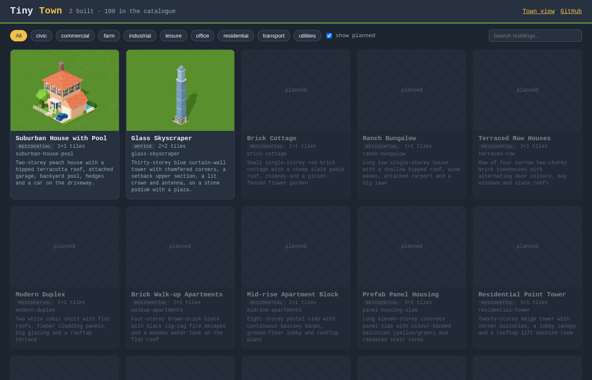

# Tiny Town

100 low-poly, OpenTTD-style 3D buildings made with [three.js](https://threejs.org) and Vite.
Each building lives in its own folder and is built in its own PR.



```bash
npm install
npm run dev                     # gallery at http://localhost:5173/
npm run check                   # validate every building (or: npm run check -- <slug>)
npm run shots -- <slug>         # render buildings/<slug>/shots/*.png in headless Chrome
npm run build                   # static site in dist/
```

- `index.html`: gallery. It finds `buildings/*/building.js` + `meta.json` automatically and shows the planned ones from the catalogue.
- `view.html?b=<slug>`: one building on a ground tile with orbit controls.
- `town.html`: every built building on one map.
- [CATALOGUE.md](CATALOGUE.md): the 100 planned buildings.
- [CONTRIBUTING.md](CONTRIBUTING.md): rules for building PRs and the `src/lib` API guide.

## Layout

```
buildings/<slug>/   one folder per building (building.js, meta.json, shots/)
src/lib/            frozen shared helpers: units, palette, materials, textures, parts
src/app/            gallery, viewer, town and shots pages
scripts/            check.mjs, shots.mjs
```
